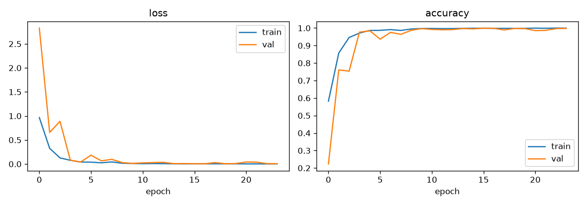
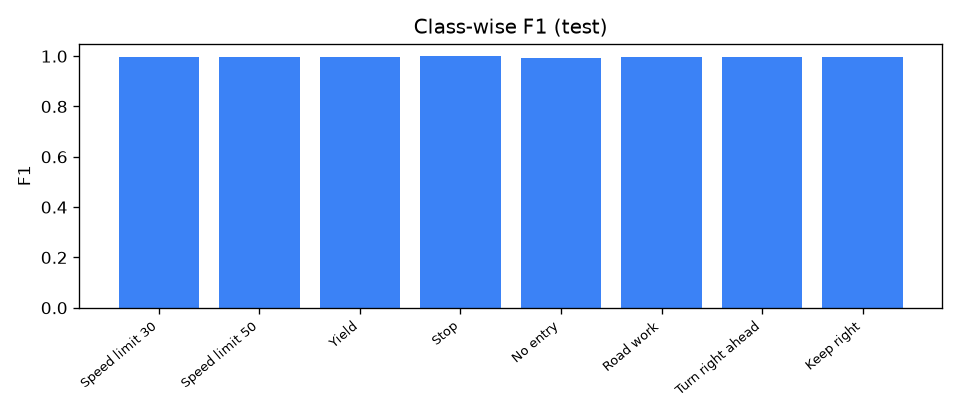
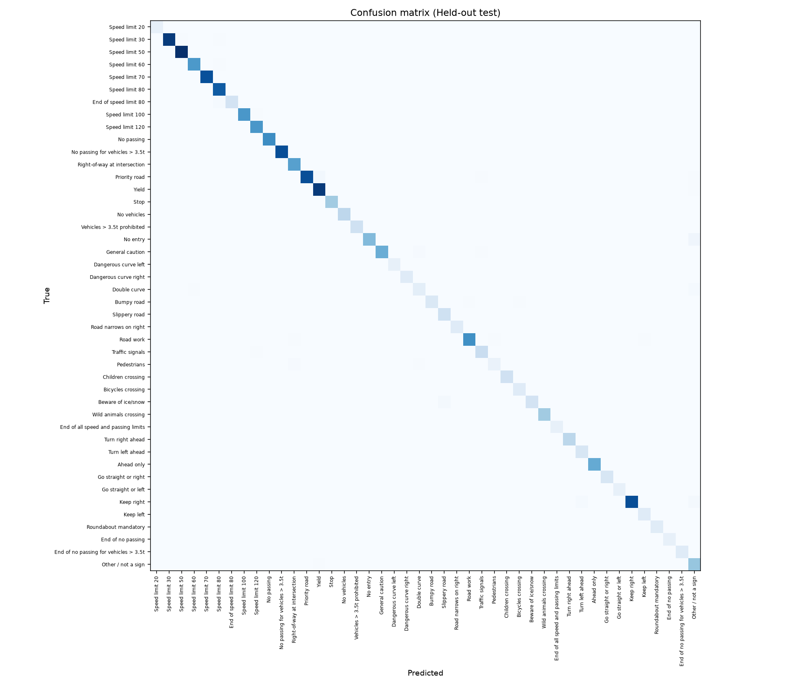

# 🚦 Traffic Sign Classifier — Model Report

## Model Architecture
- **Type:** Deep Residual CNN with skip connections, batch normalization, and dual pooling (GAP + GMP)
- **Classes:** 44 total (43 GTSRB traffic signs + 1 "Other / not a sign")
- **Input Size:** 48×48 RGB
- **Training:** Adam optimizer (lr=1e-3), EarlyStopping (patience=6), ReduceLROnPlateau, 25 epochs

---

## ✅ Test Accuracy

| Metric | Value |
|--------|-------|
| **Overall Test Accuracy (44 classes)** | **97.63%** |
| Traffic Sign Accuracy (43 sign classes) | 98.33% |
| "Other / not a sign" Accuracy | 91.46% |
| Test Samples | 4,680 |

---

## 📊 Training History (Loss & Accuracy)



**Key observations:**
- Loss drops sharply in the first 5 epochs → model learns fast
- Train & val curves converge tightly after epoch 10 → **no overfitting**
- Final accuracy plateaus at ~98-99% for both train and validation

---

## 🔥 Per-Class Performance (F1 Scores)

| Class | Precision | Recall | F1-Score | Test Samples |
|-------|-----------|--------|----------|--------------|
| Speed limit 30 | 99.30% | 98.75% | 99.03% | 720 |
| Speed limit 50 | 96.75% | 99.20% | 97.96% | 750 |
| Yield | 100.0% | 99.58% | 99.79% | 720 |
| **Stop** | **100.0%** | **100.0%** | **100.0%** | 270 |
| No entry | 100.0% | 90.00% | 94.74% | 360 |
| Road work | 98.55% | 98.96% | 98.75% | 480 |
| Turn right ahead | 98.59% | 100.0% | 99.29% | 210 |
| Keep right | 99.56% | 98.41% | 98.98% | 690 |
| Other / not a sign | 86.59% | 91.46% | 88.96% | 480 |

> **Best:** Stop sign = 100% perfect — zero misclassifications!
>
> **Weakest:** "Other / not a sign" class (F1 = 88.96%) — expected because it's built from synthetic + CIFAR data.



---

## 🧮 Confusion Matrix



### Key Confusion Patterns:

| True Class | Misclassified As | Count | Analysis |
|-----------|-----------------|-------|----------|
| **No entry** | Other / not a sign | **36** | Biggest confusion — 10% No entry signs classified as "Other" |
| **Other / not a sign** | Speed limit 50 | **24** | Some non-signs confused with Speed limit 50 |
| **Keep right** | Other / not a sign | **11** | 1.6% Keep right signs rejected as "Other" |
| Speed limit 30 | Other / not a sign | 8 | Minor confusion |
| Road work | Other / not a sign | 5 | Minor confusion |

> The matrix is strongly diagonal — model performs very well across all classes.

---

## 📈 Summary

```
┌─────────────────────────────────────┬──────────┐
│ Overall Test Accuracy               │  97.63%  │
│ Sign Classes Accuracy (43 classes)  │  98.33%  │
│ Other Class Accuracy                │  91.46%  │
│ Macro Avg F1                        │  97.50%  │
│ Weighted Avg F1                     │  97.64%  │
│ Best Class (Stop)                   │ 100.00%  │
│ Weakest Class (Other/not a sign)    │  88.96%  │
└─────────────────────────────────────┴──────────┘
```

---

## ⚠️ Disclaimer

> Educational demo only. Model is NOT suitable for real driving or any safety-critical use.
