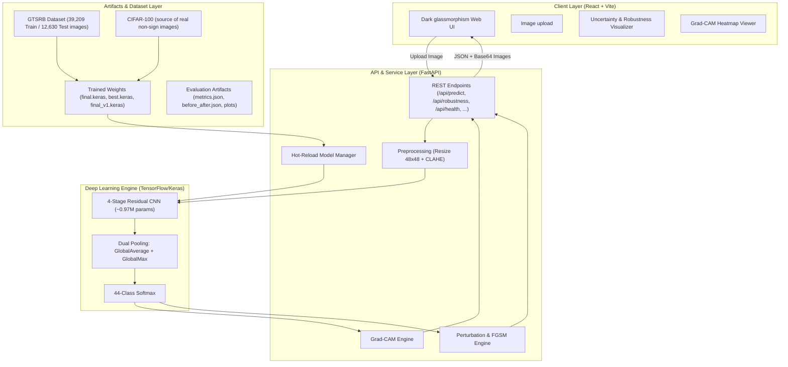
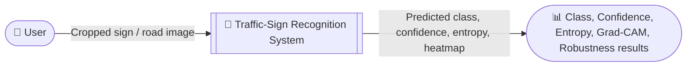
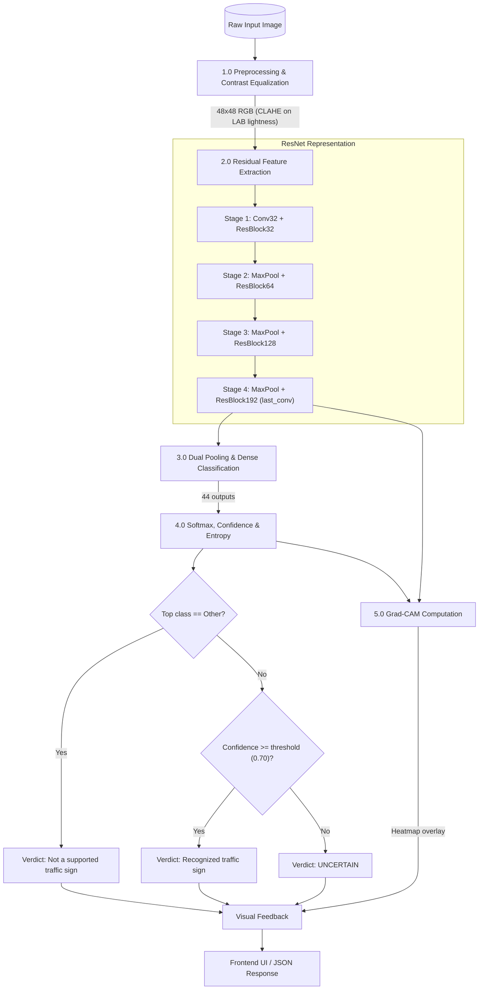

# 🚦 Traffic-Sign Recognition System with Open-Set Rejection

[](https://www.python.org/)
[](https://www.tensorflow.org/)
[](https://opencv.org/)
[](https://fastapi.tiangolo.com/)
[](https://react.dev/)
[](https://vitejs.dev/)

> ⚠️ **SAFETY DISCLAIMER**: **Educational demo only. Model is NOT suitable for real driving or any safety-critical use.** Real-world autonomous vehicle perception requires multi-sensor fusion (LiDAR, Radar, Cameras), temporal tracking, high-frequency redundancy, and rigorous ASIL-D automotive safety certification.

**Live demo:** [dltrafficsign.vercel.app](https://dltrafficsign.vercel.app)

---

## 📌 Executive Summary

This project is a full-stack educational **deep-learning system** that classifies traffic signs from the benchmark **GTSRB (German Traffic Sign Recognition Benchmark)** and learns to **reject inputs that are not traffic signs**.

**Scope:** the model is an *image classifier* for already-cropped sign images (48×48 after preprocessing). It does **not** locate signs inside a full road scene (no object detection / bounding boxes).

Beyond a standard closed-set classifier, the project includes:

- **Open-set rejection**: 43 traffic-sign classes + 1 explicit "Other / not a sign" class
- **Grad-CAM** visual explainability
- **Shannon-entropy** uncertainty estimate returned with every prediction
- **Robustness testing**: brightness, blur, noise, rotation, occlusion and the **FGSM** adversarial attack
- A **React web dashboard** backed by a **FastAPI** service

---

## 🎯 The Core Problem & Our Solution

### The Closed-Set Failure Mode
Most academic classifiers operate under a **closed-set assumption**: the network assumes every image it sees *must* belong to one of its predefined classes.

- **Real-world hazard**: when the camera sees a traffic light, a billboard or a tree, a closed-set model still has to output one of its known sign names, often with high confidence (for example, "Speed limit 30" at 87%; *illustrative numbers*).
- Confidence thresholding alone (e.g. `max softmax >= 0.70`) is often not enough, because neural networks can be overconfident on inputs unlike anything they were trained on. The earlier closed-set baseline (v1) accepted **87.5%** of unseen sign images at a 0.70 threshold (see [Results](#-evaluation--results-summary)).

### The Solution: Open-Set Class + Synthetic Negatives

1. **44-class output space**
   - **Classes 0 to 42**: all 43 German traffic-sign classes of GTSRB.
   - **Class 43 ("Other / not a sign")**: an explicit negative class trained on
     - 500 real non-sign images sampled from **CIFAR-100**, and
     - 500 **synthetic negatives** drawn by code: traffic lights (dark housing with a lit red/yellow/green lamp on varied backgrounds) and coloured circular discs.
2. **Uncertainty signals**
   - **Confidence**: $P(\hat{y}) = \max_k P(y=k \mid x)$
   - **Normalized Shannon entropy** (K = 44): $H(P) = -\frac{1}{\ln K} \sum_{k=1}^{K} p_k \ln p_k$
   - `predict.py` prints **`UNCERTAIN`** when confidence is below a threshold (default `0.70`, configurable with `--threshold`). The API returns both confidence and entropy with every prediction so a client can apply its own gating rule.
3. **Visual explainability (Grad-CAM)**
   - Gradients of the predicted class are taken with respect to the `last_conv` layer, giving a coarse (6×6, upsampled) heatmap of the regions that influenced the prediction.

---

## 🏛️ System Architecture



---

## 🔄 Data Flow Diagrams (DFD)

### Level 0 DFD (Context Diagram)



### Level 1 DFD (Decomposed Process Flow)



---

## 🧠 Machine Learning Pipeline & Architecture

### 1. Contrast Normalization (CLAHE)
Real driving conditions have a wide dynamic range (direct sunlight, night, tunnels, fog). To reduce sensitivity to lighting:

- Images are resized to 48×48 (`INTER_AREA`) and converted from **BGR to LAB**.
- **CLAHE (Contrast Limited Adaptive Histogram Equalization)** with `clipLimit=2.0` and `tileGridSize=(4, 4)` is applied only to the **lightness (L)** channel.
- The image is converted back to RGB, which boosts local contrast of faded symbols while leaving colour information largely unchanged.

```python
_clahe = cv2.createCLAHE(clipLimit=2.0, tileGridSize=(4, 4))
def preprocess(img_bgr):
    img = cv2.resize(img_bgr, (48, 48), interpolation=cv2.INTER_AREA)
    lab = cv2.cvtColor(img, cv2.COLOR_BGR2LAB)
    lab[..., 0] = _clahe.apply(lab[..., 0])
    return cv2.cvtColor(lab, cv2.COLOR_LAB2RGB)
```

The same `preprocess()` is used for training, evaluation and the API.

### 2. Residual CNN Architecture
A custom 4-stage ResNet-style network for 48×48 inputs (≈ 0.97 M parameters in total, including BatchNorm statistics):

```
Input: (48, 48, 3)
│
├── Augmentation (training only): Rotation, Zoom, Translation, Contrast
├── Rescaling (1 / 255.0)
├── Conv2D (32 filters, 3x3, same) + BatchNorm + ReLU
│
├── [ResBlock 1]: 2x Conv2D(32, 3x3) + BatchNorm + Skip Connection
├── MaxPooling2D(2x2) + Dropout(0.15)                   --> (24, 24, 32)
│
├── [ResBlock 2]: 2x Conv2D(64, 3x3) + BatchNorm + Skip Connection
├── MaxPooling2D(2x2) + Dropout(0.20)                   --> (12, 12, 64)
│
├── [ResBlock 3]: 2x Conv2D(128, 3x3) + BatchNorm + Skip Connection
├── MaxPooling2D(2x2) + Dropout(0.25)                   --> (6, 6, 128)
│
├── [ResBlock 4]: 2x Conv2D(192, 3x3) + BatchNorm + Skip Connection --> (6, 6, 192)
│       (second Conv2D of this block is named "last_conv", used by Grad-CAM)
│
├── Dual Pooling:
│   ├── GlobalAveragePooling2D (192 dims)
│   ├── GlobalMaxPooling2D     (192 dims)
│   └── Concatenate            (384 dims)
│
├── Dense(192, ReLU) + BatchNormalization + Dropout(0.40)
└── Dense(44, Softmax)                                  --> Output Probabilities
```

A 1×1 convolution is used on the skip path whenever the number of channels changes.

- **Why dual pooling?** Global average pooling summarises the whole feature map, while global max pooling keeps the strongest local response (useful for small distinguishing details such as the digits on speed-limit signs).

### 3. Training Details
- **Loss / optimizer**: sparse categorical cross-entropy, Adam (learning rate 1e-3).
- **Class weights**: `balanced` weights computed from the training split.
- **Callbacks**: `EarlyStopping` (patience 6 on `val_accuracy`, restores best weights), `ReduceLROnPlateau` (factor 0.5, patience 2), `ModelCheckpoint` (saves `best.keras`).
- **Resolution diversity**: during data loading, images are randomly down/up-scaled or Gaussian-blurred so the network cannot rely on resolution differences between sign images and non-sign images.

### 4. Data Leakage Prevention (Group-Aware Splitting)
In GTSRB, each physical sign appears as a 30-frame sequence. Randomly splitting frames would put near-identical images in both train and validation sets and inflate validation accuracy.

- The training pipeline extracts the **track ID** from the file name (`<class>_<track>_<frame>.png`).
- It uses `GroupShuffleSplit` (15% validation) so **all frames of a physical sign go to either train or validation, never both**.
- Final metrics are computed on the official GTSRB `Test.csv` set, which is separate from this split.

---

## 📊 Dataset & Class Distribution

The model is trained on **44 classes**. GTSRB provides 39,209 training and 12,630 test images (43 classes); the "Other" class adds up to 1,000 training and 300 test images (see below).

| Category | Classes Included |
| :--- | :--- |
| **Speed Limits** | 20, 30, 50, 60, 70, 80, 100, 120 km/h |
| **Prohibitory** | No passing, No passing for vehicles > 3.5t, No vehicles, Vehicles > 3.5t prohibited, No entry |
| **Priority & Mandatory** | Priority road, Yield, Stop, Right-of-way at intersection, Ahead only, Turn right/left ahead, Go straight or right/left, Keep right/left, Roundabout mandatory |
| **Danger & Warning** | General caution, Dangerous curve left/right, Double curve, Bumpy road, Slippery road, Road narrows on right, Road work, Traffic signals, Pedestrians, Children crossing, Bicycles crossing, Beware of ice/snow, Wild animals crossing |
| **End of Restrictions** | End of speed limit 80, End of all speed and passing limits, End of no passing, End of no passing for vehicles > 3.5t |
| **Open-Set Negative** | **Class 43: "Other / not a sign"**: real CIFAR-100 images (500 train / 150 test) + synthetic traffic lights and coloured discs (500 train / 150 test) |

> **Note:** CIFAR-100 images are loaded only if `data_cifar/train` and `data_cifar/test` exist. If they are missing, `train.py` silently skips them and the "Other" class contains only the synthetic images.

---

## 🔬 Explainability & Robustness Testing

### 1. Grad-CAM (Gradient-Weighted Class Activation Mapping)
For the predicted class score $y^c$ and the feature maps $A^k$ of the `last_conv` layer (the second convolution of the final residual block, taken before its BatchNorm and skip-addition):

$$\alpha_k^c = \frac{1}{Z} \sum_{i} \sum_{j} \frac{\partial y^c}{\partial A_{i,j}^k}$$

$$L_{\text{Grad-CAM}}^c = \text{ReLU}\left(\sum_k \alpha_k^c A^k\right)$$

The map is normalized to [0, 1] and overlaid on the input. Because the feature map is only 6×6, the heatmap is coarse. It helps check whether the network attends to the sign pictogram rather than the background, but it is a diagnostic aid, not proof of correct reasoning.

### 2. Robustness Sweeps (`POST /api/robustness`)
Each sweep runs the same image through 7 increasing levels and reports the prediction and confidence at each level:

| Test | Levels |
| :--- | :--- |
| Brightness | −120 … +120 |
| Blur (Gaussian kernel) | 1 … 15 |
| Gaussian noise (σ) | 0 … 100 |
| Rotation (degrees) | −40 … +40 |
| Occlusion (centre patch, fraction of side) | 0.0 … 0.6 |
| **FGSM adversarial attack** | ε ∈ {0, 1, 2, 4, 8, 16, 32} (pixel intensity, 0–255 scale) |

**FGSM (Fast Gradient Sign Method)** perturbs the preprocessed image in the direction that increases the loss of the model's *own current prediction*:

$$x_{\text{adv}} = x + \epsilon \cdot \text{sign}\left(\nabla_x J(\theta, x, \hat{y})\right)$$

Small ε values are nearly invisible to a human, yet can change the prediction, which shows how fragile neural classifiers can be.

---

## 🌐 API Endpoints

| Method | Endpoint | Purpose |
| :--- | :--- | :--- |
| GET | `/api/health` | Service status, class list, disclaimer |
| POST | `/api/predict` | Single image → class, probabilities, confidence, entropy, Grad-CAM |
| POST | `/api/batch` | Multiple images → prediction, confidence, entropy per file |
| GET | `/api/perturbations` | List available robustness tests |
| POST | `/api/robustness` | Run a robustness sweep (including FGSM) on one image |
| GET | `/api/report` | `metrics.json` plus available result plots |
| GET | `/api/advanced` | Contents of `advanced.json` (from `evaluate_advanced.py`) |
| GET | `/api/before_after` | Contents of `before_after.json` |

The API loads whichever of `outputs/final.keras` / `outputs/best.keras` is newer and reloads it automatically when the file changes.

---

## 📁 Repository Structure

```
traffic-sign/
├── common.py                # Class names, mappings, CLAHE preprocessing, safety disclaimer
├── train.py                 # 44-class ResNet training pipeline, group split, callbacks, plots
├── predict.py               # Single-image CLI inference + Grad-CAM generation
├── check_folder.py          # Batch evaluation of a folder of images
├── evaluate_advanced.py     # Calibration (ECE), AUROC, before/after comparison (see Known Limitations)
├── api.py                   # FastAPI backend with hot-reload model manager & Grad-CAM
├── render.yaml              # Render deployment config (backend)
├── vercel.json              # Vercel deployment config (frontend)
├── start.sh                 # Startup script
├── requirements.txt         # Python dependencies
├── outputs/                 # Generated artifacts
│   ├── final.keras          # Active trained model
│   ├── best.keras           # Best validation checkpoint
│   ├── final_v1.keras       # Earlier 8-class closed-set baseline (preserved)
│   ├── metrics.json         # Classification report & accuracy numbers
│   ├── before_after.json    # False-accept-rate comparison (v1 vs v2)
│   ├── history.png          # Training & validation loss/accuracy curves
│   ├── confusion_matrix.png # 44-class confusion matrix
│   ├── class_f1.png         # Class-wise F1 scores
│   ├── examples.png         # Ground-truth vs predicted sample grid
│   └── difficult_examples.png # Misclassified & low-confidence examples
└── frontend/                # React 18 + Vite web application
    ├── package.json
    ├── vite.config.js
    └── src/
        ├── App.jsx          # Interactive lab UI (Prediction, Grad-CAM, Robustness)
        ├── Advanced.jsx     # Evaluation dashboard (Reliability, ECE, Explorer)
        ├── api.js           # API adapter (localhost:8000 ↔ Render production)
        └── styles.css       # Dark glassmorphism theme
```

---

## 🚀 Getting Started & Execution Guide

### 1. Environment Setup

```powershell
# Windows PowerShell
git clone https://github.com/Alokzhan/traffic-sign.git
cd traffic-sign

python -m venv .venv
.\.venv\Scripts\Activate.ps1
pip install -r requirements.txt
```

### 2. Datasets (needed only for training / evaluation)

- **GTSRB**: download and extract so the folder contains `Train/<class_id>/*.png`, `Test/`, and `Test.csv`. Pass this folder with `--data`.
- **CIFAR-100** (for the "Other" class): place the Python-version files `train` and `test` in `data_cifar/` at the repository root, i.e. `data_cifar/train` and `data_cifar/test`.

### 3. Running Localhost Services

The backend needs a trained model at `outputs/final.keras` (included in `outputs/`, or produced by `train.py`).

#### Start FastAPI Backend:
```powershell
.\.venv\Scripts\uvicorn api:app --host 127.0.0.1 --port 8000
```
- API Base: `http://127.0.0.1:8000`
- Interactive Swagger Docs: `http://127.0.0.1:8000/docs`

#### Start React + Vite Frontend:
```powershell
cd frontend
npm install
npm run dev -- --host 127.0.0.1
```
- Web Application: `http://127.0.0.1:5173`

---

### 4. Command-Line Tools

#### A. Single image prediction + Grad-CAM
```powershell
python predict.py --model outputs/final.keras --image path/to/sign.png --cam outputs/gradcam.png --threshold 0.70
```
Prints the top-3 predictions and one of: a sign name, `UNCERTAIN` (confidence below the threshold), or "not one of the supported traffic signs" (class "Other").

#### B. Batch folder testing
```powershell
python check_folder.py --model outputs/final.keras --folder path/to/your_images
```
Use a folder of your own images (for example photos of traffic lights or other non-signs). No such folder is included in this repository.

#### C. Model retraining
```powershell
python train.py --data "C:\path\to\GTSRB" --out outputs --epochs 25 --batch 128
```

#### D. Advanced evaluation & calibration (ECE / AUROC)
```powershell
python evaluate_advanced.py --data "C:\path\to\GTSRB" --out outputs
```
See [Known Limitations](#-known-limitations) before relying on the unseen-sign numbers this script produces.

---

## 📈 Evaluation & Results Summary

- **Test accuracy**: `train.py` evaluates the model on the official GTSRB `Test.csv` plus 300 "Other" test images and writes overall accuracy, accuracy on the 43 sign classes, accuracy on the "Other" class, and a full per-class report to `outputs/metrics.json`. Plots are saved next to it.
- **Earlier baseline (v1)**: the closed-set 8-class model (`final_v1.keras`) accepted **87.5%** of images from 8 unseen sign classes at confidence ≥ 0.70, i.e. it confidently mislabelled almost every unseen sign.
- **Calibration (ECE)**: `evaluate_advanced.py` computes a 10-bin Expected Calibration Error to check whether confidence values match empirical accuracy.

---

## ⚠️ Known Limitations

- **Classification only**: signs must already be cropped; there is no sign detection or localisation in full scenes.
- **"Other" evaluation is in-distribution**: the "Other" test images come from the same sources (CIFAR-100 and the same synthetic generator) as the training negatives. High accuracy on this class does not guarantee correct rejection of real-world traffic lights, billboards or other objects.
- **Unseen-sign evaluation is outdated**: `evaluate_advanced.py` and the "held-out classes" in `common.py` were written for the earlier 8-class model. The current model is trained on all 43 GTSRB sign classes, so those classes are no longer unseen, and parts of the script still use 8/9-class indices. Update the script before reporting unseen-sign false-accept numbers for the 44-class model.
- **Uncertainty rule**: the CLI applies only a confidence threshold. Entropy is computed and returned by the API, but no entropy cut-off is enforced in the backend.
- **Robustness**: accuracy drops under strong perturbations and adversarial noise (see the robustness sweeps). The model has not been tested on real driving footage.
- **Educational use only**: not validated for any safety-critical application.

---

## 📜 License & Acknowledgments
- **Dataset**: German Traffic Sign Recognition Benchmark (GTSRB) by Institut für Neuroinformatik, Ruhr-Universität Bochum.
- **CIFAR-100**: Canadian Institute for Advanced Research.
- **License**: MIT Open Source License. Educational and research use only.
